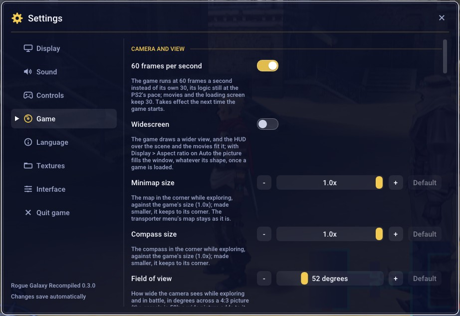

# Rogue Galaxy Recompiled

**Rogue Galaxy** (Level-5 / SCE, PlayStation 2) as a native Windows game: a
static recompilation of the USA release (SCUS-97490), built on
[PS2Recomp](https://github.com/ran-j/PS2Recomp)
([how it works](docs/HOW-IT-WORKS.md)). You build it from your own disc
image; nothing of the game is distributed.

  
  

- 60 fps
- Widescreen
- Up to 8x internal resolution
- In-game menu (F1)
- [New game settings](docs/OPTIONS.md)
- Japanese voices and movies (undub)
- [Texture packs](docs/TEXTURE_PACKS.md), PCSX2's included

## What to expect

This is an early pre-release (0.2.0). The whole game plays, but:

- **It has not been played from start to finish.** Most testing covers the
  early game; later chapters, the Factory and Insectron are unchecked.
- **Expect bugs**: graphics glitches, slowdowns, maybe a freeze. Save often,
  in more than one slot, and back up `disc\mc0` now and then.
- **Only the USA disc** (SCUS-97490) works.

Known issues are in the [CHANGELOG](CHANGELOG.md); what is being worked on
is in [docs/STATUS.md](docs/STATUS.md).

**Found a problem?** Open an [issue](../../issues), say what you were doing
and attach `build\last-run.log` (`install.log` for the install). The log of
the run before is `build\last-run.prev.log`.

## Install (Windows)

You need Windows 10 or 11 (64-bit), about 16 GB free, an internet
connection and your own image of Rogue Galaxy USA (SCUS-97490). It must be
an uncompressed `.iso`, as Redump's (6,967,721,984 bytes); turn a `.chd` or
`.cso` back into an `.iso` first ([DISC.md](docs/DISC.md)).

1. Download `RogueGalaxy-<version>.zip` from the [releases](../../releases)
   page (not "Source code").
2. Extract it to a short path, such as `C:\`. You get `C:\RogueGalaxy`,
   your game folder.
3. Double-click `Install.bat` and choose your disc image.
4. Wait about 20 minutes on a fast PC, up to an hour on a slower one. It
   downloads the build tools (about 300 MB) into the folder, extracts the
   disc and builds the game. Nothing is installed in Windows.
5. Play with `Rogue Galaxy.exe`.

If it stops, `install.log` says why; run `Install.bat` again to continue.
If an antivirus removes the compiler, restore it and run it again.

### Undub (optional)

You need your own image of the Japanese Director's Cut (SCPS-17013). After
installing, double-click `Install-Undub.bat` and choose that image (or drop
it onto the file); it copies about 3 GB of voices and movies. Then turn it
on in [F1 > Settings > Language](docs/OPTIONS.md#language) and restart the
game. The text stays English.

### Update

The game tells you at start when a new version is out; nothing updates by
itself. To update, double-click `Update.bat`: it downloads the newest release and rebuilds
only what changed. That takes a few minutes, or about as long as the first
install when the new version changes how the game's code is translated.

Your disc, saves, settings, textures and undub files are kept. `update.log`
says what happened. A zip downloaded by hand from the
[releases](../../releases) page can be dropped onto `Update.bat`.

Updating from 0.1.0, or into a new folder

**From 0.1.0**, which has no `Update.bat`: extract the new zip where your
game folder is (for `C:\RogueGalaxy`, into `C:\`), let Windows replace the
files, and run `Install.bat` again. It does not ask for the disc image.
From then on, use `Update.bat`.

**Into a new folder**: everything is downloaded and built again, as the
first time. Copy `disc\mc0` and `disc\mc1` from the old folder to keep your
saves, and `disc\JA` to keep the undub.

### Saves from PCSX2

The memory card, `disc\mc0`, has the same layout as a PCSX2 folder memory
card, so saves copy over as they are.

1. In PCSX2's memory card settings, convert your card to a folder card
   (keep the original).
2. Back up `disc\mc0`: a save with the same folder name replaces the one in
   that slot.
3. Copy the card's `BASCUS-97490LV5RG_xx` folders, one per save, into
   `disc\mc0`.

Only saves from the USA release work.

### Uninstall

Delete the game folder (your saves are in `disc\mc0`) and
`%APPDATA%\RogueGalaxy\Recompiled` (settings and screenshots).

## Controls

Keyboard or gamepad (PlayStation layout).

| Pad | Keyboard |
|---|---|
| Left stick | W A S D |
| D-pad | Arrow keys |
| ✕ / ○ / ▢ / △ | X or Space / C or Esc / Z / V |
| L1 / R1 / L2 / R2 | Q / E / Left Shift / Right Shift |
| L3 / R3 | R / F |
| Start / Select | Enter / Tab |
| Right stick | I J K L |

F11 or Alt+Enter toggles fullscreen. F12 takes a screenshot.

### The F1 menu

**F1** (or the Guide button, or Back+Start) opens the menu: display, sound,
controls, the game options, Language (the undub) and Textures. Most game
options are also on the game's own Settings screen (System > Settings).
Every option and where it is: [docs/OPTIONS.md](docs/OPTIONS.md).

With a controller: ✕ opens a page, ○ goes back, △ reaches the menu bar,
L1 and R1 turn the pages.

## More

Every page, by who it is for: [docs/README.md](docs/README.md). The main
ones:

- [CHANGELOG.md](CHANGELOG.md): each release, and its known issues
- [docs/OPTIONS.md](docs/OPTIONS.md): every option
- [docs/HOW-IT-WORKS.md](docs/HOW-IT-WORKS.md): the project in plain words
- [docs/STATUS.md](docs/STATUS.md): where things stand, and the work log
- [docs/BUILDING.md](docs/BUILDING.md): building by hand
- [docs/HOOKS.md](docs/HOOKS.md): changing the game's behaviour

## Legal

You must own the game. No game data, BIOS or disc-derived files are part of
this repository: `disc/` and disc images are gitignored and must never be
committed.

## Credits

- [PS2Recomp](https://github.com/ran-j/PS2Recomp) by ran-j, and the
  [fork](https://github.com/Sinan-Karakaya/PS2Recomp) by Sinan Karakaya.
- [DQ8-Recompiled](https://github.com/Sinan-Karakaya/DQ8-Recompiled) by Sinan
  Karakaya, the reference for MWo3 overlays on PS2Recomp, and the source of
  the SDL3 GPU GS backend and the in-game menu in `thirdparty/dq8-gfx`.
- [Dear ImGui](https://github.com/ocornut/imgui) by Omar Cornut (MIT), which
  the menu is drawn with, and its Roboto Medium font (Apache 2.0).
- [RGDecomp](https://github.com/Dorgengoa/RGDecomp) (CC0), the function maps
  and names for this build (`config/SCUS_974.90/functions_*.csv` derive from
  it).
- [Redump](http://redump.org/disc/6567/) and [PCSX2](https://github.com/PCSX2/pcsx2)
  (GameDB, patches) for disc and hardware notes.

## License

GPL-3.0, the same as PS2Recomp, which the built executable links. See
[`LICENSE`](LICENSE).
