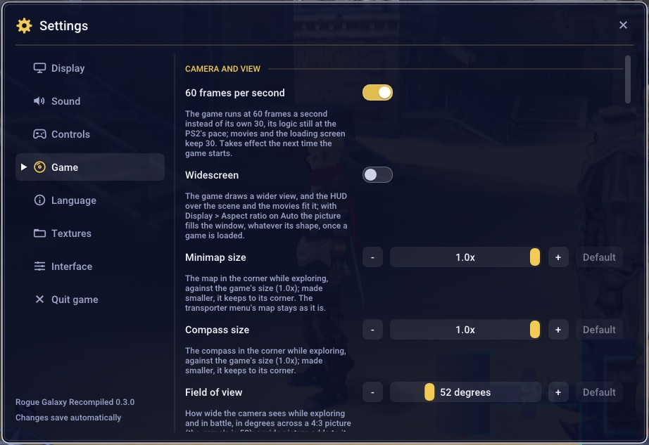

# Rogue Galaxy Recompiled

**Rogue Galaxy** (Level-5 / SCE, PlayStation 2) as a native game for the Steam Deck: a
static recompilation of the USA release (SCUS-97490), built on
[PS2Recomp](https://github.com/ran-j/PS2Recomp)
([how it works](docs/HOW-IT-WORKS.md)). You build it from your own disc
image; nothing of the game is distributed.

This repository is a fork of
[victor-takai/rogue-galaxy-recomp](https://github.com/victor-takai/rogue-galaxy-recomp)
made for **one machine: the Steam Deck (SteamOS)**. Windows, macOS and other
Linux setups are not supported here.

  
  

- 60 fps
- 16:10 picture, the Steam Deck's screen
- Up to 8x internal resolution
- In-game menu (View + Menu on the Deck)
- [New game settings](docs/OPTIONS.md)
- Japanese voices and movies (undub)
- [The Japanese Director's Cut's](docs/DIRECTORS-CUT.md) battle balance,
  enemy behavior and party AI, as options
- Text in French, German, Spanish or Italian (experimental)
- [Texture packs](docs/TEXTURE_PACKS.md), PCSX2's included

## What to expect

This is an early pre-release (0.3.0). The whole game plays, but:

- **It has not been played from start to finish.** Most testing covers the
  early game; later chapters, the Factory and Insectron are unchecked.
- **Expect bugs**: graphics glitches, slowdowns, maybe a freeze. Save often,
  in more than one slot, and back up `disc/mc0` now and then.
- **Only the USA disc** (SCUS-97490) works.

Known issues are in the [CHANGELOG](CHANGELOG.md); what is being worked on
is in [docs/STATUS.md](docs/STATUS.md).

**Found a problem?** Open an [issue](../../issues/new/choose): its form asks
what you were doing, the version (menu > Rogue Galaxy > About) and
`build/last-run.log`. The log of the run
before is `build/last-run.prev.log`. Rules for issues and pull requests:
[CONTRIBUTING.md](CONTRIBUTING.md).

## Install (Steam Deck)

You need about 24 GB free (the SD card is fine), an internet connection and
your own uncompressed `.iso` of Rogue Galaxy USA (SCUS-97490).

1. In desktop mode, download `RogueGalaxy-Setup-x86_64.AppImage` from the
   [releases](../../releases) page and double-click it (Execute).
2. Pick your disc image and where to install the game. It builds on the Deck
   in 10 to 30 minutes and adds the game to Steam.
3. Switch to game mode and play. The game opens on a home screen with
   **Play** and **Update**; nothing else needs desktop mode, and the
   installer is not needed again.

SteamOS has no compiler, so the build runs in a container (distrobox) the
installer sets up itself. The game then runs on the Deck as it is. View +
Menu opens the game's menu; the log is `build/last-run.log`. More in
[docs/INSTALL.md](docs/INSTALL.md) and
[docs/BUILDING.md](docs/BUILDING.md#steam-deck).

## Controls

The Steam Deck's own controls work as a gamepad in game mode (Steam's
default layout for a non-Steam game; a game started from desktop mode gets
the mouse-and-keyboard layout instead). The Steam button stays Steam's.

| Deck | PS2 pad |
|---|---|
| Left stick / D-pad | Left stick / D-pad |
| Right stick | Right stick |
| A / B / X / Y | ✕ / ○ / ▢ / △ |
| L1 / R1 / L2 / R2 | L1 / R1 / L2 / R2 |
| L3 / R3 | L3 / R3 |
| Menu / View | Start / Select |

All of it can be changed in the game's menu, Settings > Controls.

### The game's menu

**View + Menu** opens the menu's top bar and its Settings window, which
has the pages: display, sound, controls, the game options, Language (the
text's language, the undub), Textures and Interface. Most game options are
also on the game's own Settings screen (System > Settings). Every option and
where it is: [docs/OPTIONS.md](docs/OPTIONS.md).

With the Deck's buttons: A opens a page, B goes back, Y reaches the top bar,
L1 and R1 turn the pages.

## More

Every page, by who it is for: [docs/README.md](docs/README.md). The main
ones:

- [docs/INSTALL.md](docs/INSTALL.md): installing, the undub, the European
  texts, updating
- [CHANGELOG.md](CHANGELOG.md): each release, and its known issues
- [docs/OPTIONS.md](docs/OPTIONS.md): every option
- [docs/HOW-IT-WORKS.md](docs/HOW-IT-WORKS.md): the project in plain words
- [docs/STATUS.md](docs/STATUS.md): where things stand, and the work log
- [docs/BUILDING.md](docs/BUILDING.md): building by hand
- [docs/HOOKS.md](docs/HOOKS.md): changing the game's behaviour

## Legal

You must own the game. No game data, BIOS or disc-derived files are part of
this repository: `disc/` and disc images are gitignored and must never be
committed.

## Credits

- [PS2Recomp](https://github.com/ran-j/PS2Recomp) by ran-j, and the
  [fork](https://github.com/Sinan-Karakaya/PS2Recomp) by Sinan Karakaya.
- [DQ8-Recompiled](https://github.com/Sinan-Karakaya/DQ8-Recompiled) by Sinan
  Karakaya, the reference for MWo3 overlays on PS2Recomp, and the source of
  the SDL3 GPU GS backend and the in-game menu in `thirdparty/dq8-gfx`.
- [Dear ImGui](https://github.com/ocornut/imgui) by Omar Cornut (MIT), which
  the menu is drawn with, and its Roboto Medium font (Apache 2.0).
- [Lucide](https://lucide.dev) (ISC; its check from Feather, MIT), whose
  gamepad-2, keyboard, rotate-ccw and check icons the menu's controller,
  keyboard, undo and check follow (`thirdparty/dq8-gfx/LICENSE-lucide.txt`).
- [RGDecomp](https://github.com/Dorgengoa/RGDecomp) (CC0), the function maps
  and names for this build (`config/SCUS_974.90/functions_*.csv` derive from
  it).
- [Redump](http://redump.org/disc/6567/) and [PCSX2](https://github.com/PCSX2/pcsx2)
  (GameDB, patches) for disc and hardware notes.

## License

GPL-3.0, the same as PS2Recomp, which the built executable links. See
[`LICENSE`](LICENSE).
