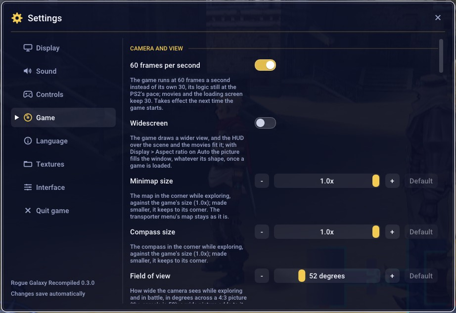
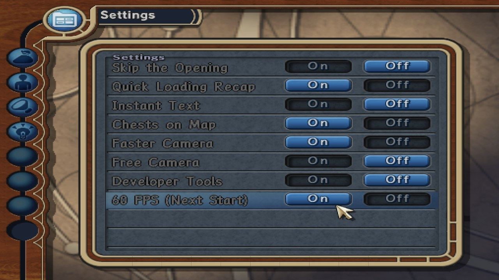
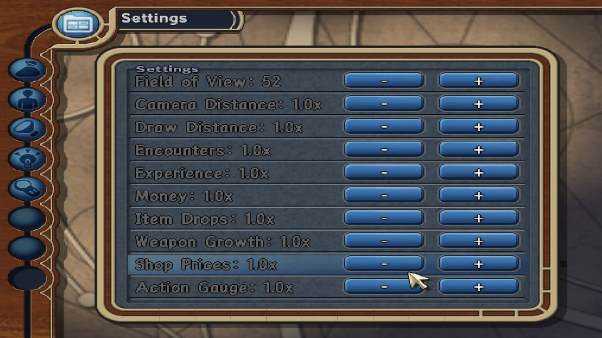

# Options

**F1** opens a menu bar at the top of the window: Rogue Galaxy (About,
Quit), Game (pause, fast-forward, mute, screenshots), Settings, View
(fullscreen, the frame-rate counter) and Help. The Guide button, or
Back+Start, opens the Settings window at once; L1 and R1 turn its pages.

With only a controller (the menu names its buttons as the controller does:
A and ✕ are the same button, B and ○, X and ▢, Y and △):

- In the page list, A or Right goes into the page; moving along the list
  shows each page.
- B comes back one level at a time: out of a slider, a list or the menu
  bar, then from the page to the page list, and from the page list to the
  game.
- Y reaches the menu bar at the top. L1 and R1 turn the pages, the left
  stick moves like the D-pad and the right stick scrolls.
- A strip along the bottom of the window names the buttons for where the
  cursor is.
- "Quit game", at the end of the page list, asks first, as does the menu
  bar's Quit.
- On Controls, X clears a binding. While one is being set, a tap of B binds
  B and holding it cancels.

Settings has seven pages, written here as F1 > Settings > Game and so on:

- **Display**: window or fullscreen, vertical sync, internal resolution
  (2x by default), aspect ratio, scaling filter, **Borders**, what fills
  the sides of a 4:3 picture (black, the picture blurred, or your own image
  from the `borders` folder), integer scaling, and **Sharper picture**,
  which drops the PS2's line blending (it only blurs on a monitor).
- **Sound**: volume and muting.
- **Controls**: controller and keyboard remapping, dead zones.
- **Game**: the game options below.
- **Language**: the undub, [below](#language).
- **Textures**: a switch for each texture pack found
  ([TEXTURE_PACKS.md](TEXTURE_PACKS.md)).
- **Interface**: the menu's size, notifications, pause and fast-forward,
  the frame-rate counter.

| Key | |
|---|---|
| F2 | Pause |
| F3 | Frame-rate counter |
| F4 | Fast-forward |
| F6 | Free camera |
| F11 or Alt+Enter | Fullscreen |
| F12 | Screenshot |
| Shift+F12 | Screenshot with the menu |

## Game options

F1 > Settings > Game, in these sections:

**Camera and view**

| Option | |
|---|---|
| 60 frames per second | On by default; off, the game's own 30. From the next start. |
| Widescreen | Off by default. A wider view, from 4:3 to 32:9; with Display > Aspect ratio on Auto (the default) it fills the window. |
| Minimap size | 50% to 100% of the game's, toward its corner. |
| Compass size | 50% to 100% of the game's, toward its corner. |
| Field of view | 40 to 90 degrees (the game's is 52). |
| Camera distance | 70% to 160% of the game's. |
| Faster camera rotation | The camera turns twice as fast. |
| Draw distance | 100% to 400% of the game's, from the next map loaded. |
| Controller's buttons | The buttons in the game's text follow an Xbox controller: A, B, X, Y, LB, RB, LT and RT, as bound in Controls. On by default. |
| Free camera (F6) | The party stands still and the controller moves the camera. Start or F6 to leave. |

**Convenience**

| Option | |
|---|---|
| Skip the opening | Straight to the title screen. |
| Show the loading recap at once | The story so far appears whole, and you can go on as soon as it has loaded. |
| Instant text | Dialogue a page at a time instead of letter by letter. |
| Chests on the map | Unopened chests show on the map in the parts explored. |
| Full bag to storage | An item found when the bag has no room for it goes to the transporter's item storage, instead of the overflow you have to sort out (or losing it when that is full too). Shops and the Factory still need room in the bag. |
| Item limit 99 | Every item that stacks can be carried up to 99 in the bag; the game holds some (healing items, boosts) to 20, 30 or 50. |
| Seventh bag page | The bag holds 280 items instead of 240; the transporter's storage keeps its 320. A save made with it loads without it too, the seventh page's items kept out of sight until it is back on. From the next start. |
| Fast transporters | Transporter warps play up to twice as fast. |
| Check for new versions | At each start, asks GitHub for this project's releases and says when a newer one is out (Rogue Galaxy > About links to it). On by default. |
| Fast Revelation Flow | Revelation Flow animations play up to twice as fast. |

**Battles and rewards**

| Option | |
|---|---|
| Encounter rate | 0% (no random battles) to 300%. |
| Experience from battles | 0% to 500%. |
| Money from battles | 0% to 500%. |
| Item drops | 0% to 1000%. |
| Weapon growth | 100% to 1000%: each battle fills a weapon's gauge (15 to full), then its attributes, by 1 point, or more. |
| Shop prices | 10% to 200%. |
| Action gauge speed | 25% to 400%. |

**Rendering**

| Option | |
|---|---|
| Native renderer | Off by default. For development: the work on drawing the game with the PC's renderer, instead of through the emulation of the PS2's graphics chip, goes behind it. It changes nothing yet. Takes effect at the next start. |

**Developers**

| Option | |
|---|---|
| Developer tools | What the developers left in the game. In the main menu: R3 shows every item (R1 + R3 as a list, Cross gives one). On the help pages and the info list, R1 + Select unlocks every entry; in the bestiary, Select fills it. R2 + Triangle on the Revelation Flow gives the items a cell needs. Triangle + R1 + R2, paused in a scene, skips it (this can break the story's order). |

  
  

## Language

F1 > Settings > Language.

| Option | |
|---|---|
| Undub (Japanese voices) | The voices in scenes and the movies come from your own Japanese Director's Cut (SCPS-17013) instead of the English ones; the text stays as it is. Needs that disc's files in `disc/JA`: double-click `Install-Undub.bat` (after `Install.bat`) and pick your Japanese disc image, or drop it onto the file; by hand, `python setup.py extract-japanese --iso "<your Japanese disc>"`. A few lines (63) have no Japanese voice and play silent. Takes effect at the next start. |

## In the game's own menu

Most of the same options, and Display > Borders, are on the game's Settings
screen (System > Settings in the main menu): L1 and R1 turn the page.
Controller's buttons, Check for new versions, Native renderer, the undub and
the texture packs are in F1 alone.

  
  

## Good to know

- The window opens as you left it. Settings are saved in
  `%APPDATA%\RogueGalaxy\Recompiled\settings.ini`, screenshots in
  `%APPDATA%\RogueGalaxy\Recompiled\screenshots` (F1 > Game > Open
  screenshots folder).
- On a 144 Hz monitor 60 fps judders a little; 120 Hz or variable refresh
  looks smoother.
- Each option also has an environment variable, for testing:
  [DEVELOPMENT.md](DEVELOPMENT.md).
